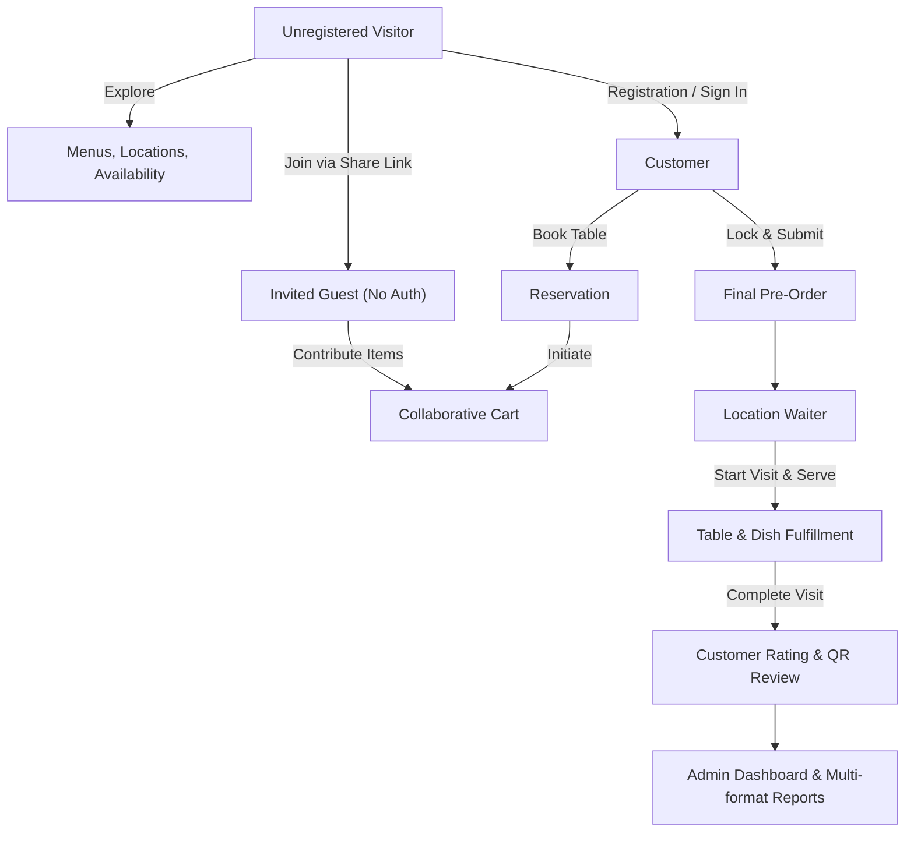
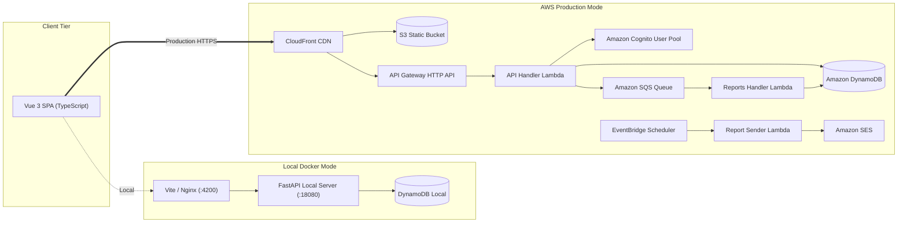

<div align="center">

# Green & Tasty

### Modern Multi-Location Restaurant Platform: Reservations, Group Pre-Orders & Analytics

[](https://www.python.org/)
[](https://fastapi.tiangolo.com/)
[](https://aws.amazon.com/lambda/)
[](https://vuejs.org/)
[](https://www.typescriptlang.org/)
[](https://aws.amazon.com/dynamodb/)
[](https://www.docker.com/)
[](https://www.terraform.io/)
[](LICENSE.txt)
[](#testing-and-quality-assurance)

<p align="center">
  <b>A comprehensive, cloud-native restaurant management ecosystem featuring real-time table reservations, collaborative group pre-ordering via shared links, dedicated staff operations, and automated analytics reports.</b>
</p>

<p align="center">
  <a href="README.md"><b>English</b></a> • <a href="README_UA.md"><b>Українська</b></a>
</p>

[Live Demo](#live-demo) • [Business Value](#business-value-and-capabilities) • [Role Capabilities](#roles-and-capabilities) • [Architecture](#architecture) • [Local Quickstart](#local-development-quickstart) • [AWS Cloud Deployment](#aws-serverless-deployment) • [Testing & QA](#testing-and-quality-assurance) • [Security & Production](#production-readiness-and-security)

</div>

---

## Live Demo

- **Application (CloudFront):** [https://d33f1c5nqdkw4l.cloudfront.net](https://d33f1c5nqdkw4l.cloudfront.net)
- **API Gateway Endpoint:** [https://57kpv9qex9.execute-api.eu-north-1.amazonaws.com/develop](https://57kpv9qex9.execute-api.eu-north-1.amazonaws.com/develop)
- **Shared Demo Password:** `GreenTasty#2026` (for local Docker) / AWS Cloud uses your configured deployment secret (e.g., `3048764c9449ca2af2E7e1fb#63`).

| Role | Demo Email | Primary Dashboard / Test Target |
|:-----|:-----------|:--------------------------------|
| **Administrator** | `admin@example.com` | Restaurant Admin, Catalog & Multi-format Reports (`/admin`) |
| **Customer (Primary)** | `customer@example.com` | Table reservation, personal & group pre-order flow (`/tables`) |
| **Customer (Secondary)** | `guest@example.com` | Guest collaboration session & invitation testing |
| **Waiter (Rustaveli)** | `waiter.rustaveli@example.com` | Rustaveli Avenue 48 live visit & order management |
| **Waiter (Rustaveli 2)** | `waiter.rustaveli2@example.com` | Multi-waiter concurrency at same location |
| **Waiter (Abashidze)** | `waiter.abashidze@example.com` | Abashidze Street 9 location management |
| **Waiter (Baratashvili)**| `waiter.baratashvili@example.com` | Baratashvili Street 14 location management |

**Try the core flow in 60 seconds:**
1. Open the [Live Demo](https://d33f1c5nqdkw4l.cloudfront.net) without logging in — browse real location photos, menus, and available seating.
2. Sign in as `customer@example.com` and book a table for tomorrow.
3. Open the reservation, create a group order link, copy the link into an Incognito window, and add dishes as an invited guest without registering.
4. Back in the owner window, submit the consolidated order.
5. Log in as `waiter.rustaveli@example.com` to review incoming pre-orders, start the visit, and confirm dishes.
6. As `admin@example.com`, inspect service analytics and download consolidated CSV/PDF/XLSX reports.

---

## Business Value and Capabilities

Traditional restaurant booking systems force customers to call in advance and handle group orders manually, leading to kitchen bottlenecks, mismatched expectations, and lost revenue during peak hours.

**Green & Tasty** bridges customer convenience and operational efficiency:
- **Collaborative Group Pre-Orders:** The table organizer generates an invitation link. Group members choose their own dishes in real time without registration; the host submits the consolidated order with zero confusion.
- **Strict Timezone Integrity:** Operating hours and booking slots strictly adhere to the restaurant's timezone (`Asia/Tbilisi`, 10:00–22:00) rather than the customer's device clock, preventing out-of-bounds reservations.
- **Waiter Flow Acceleration:** Waiters accept walk-in clients, change tables dynamically, start/finish visits, and fulfill dishes directly from mobile-optimized interfaces.
- **Enterprise Reporting:** Automated aggregation calculates revenue, guest turnover, service ratings, and dishes popularity across formats (CSV, Excel XLSX, and localized PDF reports with embedded fonts).

---

## Roles and Capabilities



| Role | Key Capabilities |
|:-----|:-----------------|
| **Visitor** | Public browsing of locations, menus, nutritional facts, prices, table schemes, and working hours; self-registration and password recovery. |
| **Customer** | Table reservation, slot rescheduling (up to 30 mins prior), pre-order cart, group order host privileges, bill splitting coordination, feedback submission. |
| **Invited Guest** | Direct access to dedicated booking carts via secure tokenized links, contributing dishes without mandatory account creation. |
| **Waiter** | Location-isolated dashboard, walk-in creation, table relocation, order line confirmation/cancellation, visit lifecycle control. |
| **Administrator** | Locations and dish catalog management, photo uploads, table layout configuration, waiter assignments, CSV/PDF/XLSX reports export. |

---

## Architecture

The project is built around clean architecture principles with a unified Python business layer capable of running seamlessly both locally in Docker and on AWS Serverless infrastructure.

```
epam-campus-ai-marathon-restaurant-project/
├── backend/
│   ├── src/lambdas/
│   │   ├── api_handler/       # API routes, services, DynamoDB repositories, models
│   │   ├── reports_handler/   # SQS worker for asynchronous visit aggregation
│   │   └── report_sender/     # Scheduled EventBridge + SES weekly report broadcaster
│   ├── local/                 # FastAPI adapter and local mock authorization for Docker
│   ├── scripts/               # Cloud automation, seeding, image upload & cleanup tools
│   ├── tests/                 # 106 isolated unit tests with Moto DynamoDB simulation
│   └── syndicate/             # AWS Syndicate deployment definitions and aliases
├── frontend/
│   ├── src/                   # Vue 3 SPA, TypeScript services, Pinia stores, router
│   │   ├── i18n/              # 5-language localization dictionaries (EN, UA, FR, ES, DE)
│   │   └── components/        # Reusable design system, reservation modals, carts
│   ├── public/assets/         # Static illustrations, logos, hero banners
│   ├── nginx.conf             # Production SPA routing container configuration
│   └── Dockerfile             # Multi-stage container build
├── terraform/                 # Infrastructure as Code: Cognito, S3, CloudFront, SQS, IAM
├── e2e/                       # 45 API and Playwright Chromium UI acceptance tests
└── Makefile                   # Unified developer CLI for local and cloud operations
```

### Local Environment vs AWS Serverless



---

## Internationalization (i18n)

The application provides first-class support for **5 languages**:
- **English (EN)** • **Українська (UA)** • **Français (FR)** • **Español (ES)** • **Deutsch (DE)**

- **Reactive Language Switch:** Instant translation switching without page reloading or losing active form inputs.
- **Dynamic Content Localization:** Restaurant catalog items and location descriptions support per-language database overrides with automatic fallback to the base description.
- **Document Localization:** Exported PDF, CSV, and XLSX reports dynamically localize table headings, currency indicators, and date formatting.
- **System Timezone Preservation:** Regardless of the client's locale or browser time, booking slots consistently adhere to the restaurant's operational timezone (`Asia/Tbilisi`).

---

## Local Development Quickstart

No AWS account is required for local execution. Everything runs inside Docker.

### Prerequisites
- [Docker Desktop](https://www.docker.com/products/docker-desktop/) (running)
- Git & Make

### 1. Launch the complete stack
```bash
# Clone the repository
git clone https://github.com/ArtemLeo/epam-campus-ai-marathon-restaurant-project.git
cd epam-campus-ai-marathon-restaurant-project

# Spin up backend, frontend, and DynamoDB Local with automatic demo seed
make up
```
Open **http://localhost:4200** in your browser.  
The API is available at **http://localhost:18080** (health check: `http://localhost:18080/health`).

### 2. Common Local Operations
```bash
make down         # Stop services while preserving local database volume
make restart      # Rebuild and restart after code changes
make seed         # Refresh / repair demo catalog data
make reset        # Complete purge of local database and uploaded photos
```

---

## AWS Serverless Deployment

Production deployment is fully automated using **Terraform** for base cloud infrastructure and **AWS Syndicate** for serverless Lambda/API packaging.

### Prerequisites
- AWS CLI v2 configured (`aws sts get-caller-identity`)
- Terraform >= 1.10
- Node.js >= 20.x & Python 3.12+

### Deployment Lifecycle

```text
make aws-tools                     1. Install isolated deployment dependencies (.venv-cloud)
make aws-configure                 2. Generate environment configs and aliases
make aws-init                      3. Provision Cognito, S3, CloudFront, SQS (Terraform)
DEMO_PASSWORD='...' make aws-deploy   4. Package & deploy Lambdas, API Gateway, DynamoDB + Seed
API_URL='...' make aws-frontend    5. Build & publish Vue SPA to S3 + invalidate CloudFront
DEMO_PASSWORD='...' make aws-update   6. Update Lambda code and data after code modifications
make aws-destroy                   7. Safely destroy cloud resources
```

### Step-by-Step Deployment Commands

```bash
# 1. Setup deployment tools
make aws-tools

# 2. Configure AWS region and restaurant timezone
make aws-configure AWS_REGION=eu-north-1 RESTAURANT_TIMEZONE=Asia/Tbilisi

# 3. Provision foundational cloud infrastructure
make aws-init

# 4. Deploy Backend Lambdas, API Gateway and initial Seed
export DEMO_PASSWORD="YourStrong#Password2026"
make aws-deploy

# 5. Build and publish Frontend to CloudFront
export API_URL="https://YOUR_API_ID.execute-api.eu-north-1.amazonaws.com/develop"
make aws-frontend
```

---

## Testing and Quality Assurance

The codebase adheres to strict testing standards across unit, integration, contract, and browser acceptance suites.

```bash
# Run all quality checks locally
make check        # lint + typecheck + unit tests + production build
```

### Test Suite Breakdown

| Suite | Tech Stack | Tests | Scope |
|:------|:-----------|:------|:------|
| **Backend Unit** | Pytest, Moto, Ruff | **106** | Services, conflict algorithms, permissions, DynamoDB repo layer |
| **Frontend Unit** | Vitest, Vue Test Utils | **134** | State management, pinia stores, booking modals, cart synchronization |
| **Acceptance E2E** | Playwright, Chromium | **45** | End-to-end customer bookings, guest pre-orders, waiter workflow |

```bash
# Run backend & frontend unit tests
make test

# Run isolated containerized E2E tests
make e2e-api      # Fast API lifecycle verification in Docker
make e2e-ui       # Headless Chromium acceptance tests in Docker
make e2e          # Complete end-to-end suite
```

---

## Production Readiness and Security

- **Serverless Resilience:** Stateless Lambda handlers behind API Gateway with automatic horizontal scaling and zero idle hosting costs.
- **Enterprise Authentication:** AWS Cognito User Pool with strict password policies, SMS/email verification, and secure JWT verification middleware.
- **Asynchronous Decoupled Reports:** Heavy aggregation operations are offloaded via SQS to isolated report workers, avoiding API Gateway latency spikes.
- **Idempotent Data Seeding:** Database seed routines verify existing items, preventing race conditions or duplicate entries on restarts.
- **CORS & Least-Privilege IAM:** Tight API CORS origins matching CloudFront distributions and scoped IAM roles for each Lambda microservice.

---

## License

This project is licensed under the terms of the [MIT License](LICENSE.txt).
