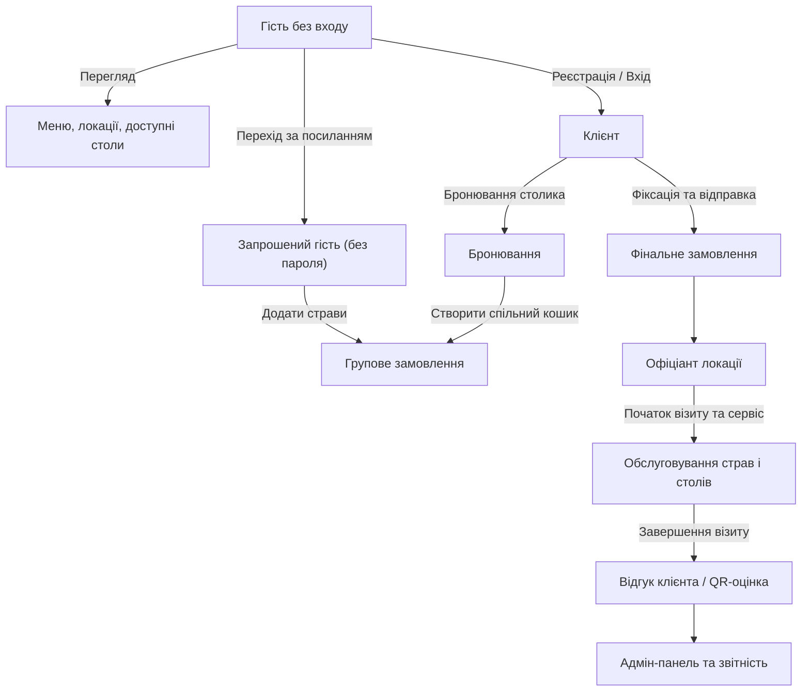
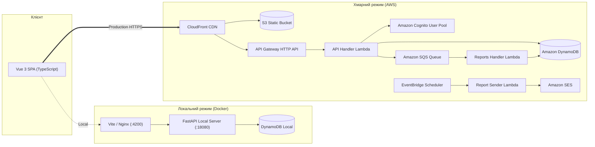

<div align="center">

# Green & Tasty

### Сучасна мультилокаційна платформа ресторану: бронювання, групові замовлення та аналітика

[](https://www.python.org/)
[](https://fastapi.tiangolo.com/)
[](https://aws.amazon.com/lambda/)
[](https://vuejs.org/)
[](https://www.typescriptlang.org/)
[](https://aws.amazon.com/dynamodb/)
[](https://www.docker.com/)
[](https://www.terraform.io/)
[](LICENSE.txt)
[](#тестування-та-контроль-якості)

<p align="center">
  <b>Хмарна екосистема для ресторанного бізнесу: інтерактивне онлайн-бронювання столиків, спільні попередні замовлення за посиланням без реєстрації гостей, мобільний інтерфейс персоналу та автоматичні аналітичні звіти.</b>
</p>

<p align="center">
  <a href="README.md"><b>English</b></a> • <a href="README_UA.md"><b>Українська</b></a>
</p>

[Демонстрація](#онлайн-демонстрація) • [Бізнес-цінність](#бізнес-цінність-і-можливості) • [Ролі користувачів](#ролі-та-можливості) • [Архітектура](#архітектура) • [Локальний запуск](#локальний-запуск-у-docker) • [AWS Деплой](#розгортання-в-aws-serverless) • [Тестування](#тестування-та-контроль-якості) • [Безпека](#готовність-до-експлуатації-та-безпека)

</div>

---

## Онлайн-демонстрація

- **Сайт (CloudFront CDN):** [https://d33f1c5nqdkw4l.cloudfront.net](https://d33f1c5nqdkw4l.cloudfront.net)
- **Точка входу API Gateway:** [https://57kpv9qex9.execute-api.eu-north-1.amazonaws.com/develop](https://57kpv9qex9.execute-api.eu-north-1.amazonaws.com/develop)
- **Спільний демо-пароль:** `GreenTasty#2026` (для локального Docker) / для хмари AWS використовується заданий під час деплою секрет (наприклад, `3048764c9449ca2af2E7e1fb#63`).

| Роль | Демо Email | Основна панель / Мета тестування |
|:-----|:-----------|:---------------------------------|
| **Адміністратор** | `admin@example.com` | Панель ресторану, каталог і мультиформатні звіти (`/admin`) |
| **Клієнт (основний)** | `customer@example.com` | Бронювання столика, особисте та спільне замовлення (`/tables`) |
| **Клієнт (гостьовий)** | `guest@example.com` | Тестування окремої клієнтської сесії та запрошень |
| **Офіціант (Руставелі)** | `waiter.rustaveli@example.com` | Управління столами та замовленнями (пр. Руставелі, 48) |
| **Офіціант (Руставелі 2)** | `waiter.rustaveli2@example.com` | Паралельна робота офіціантів на одній локації |
| **Офіціант (Абашидзе)** | `waiter.abashidze@example.com` | Локація вул. Абашидзе, 9 |
| **Офіціант (Бараташвілі)**| `waiter.baratashvili@example.com` | Локація вул. Бараташвілі, 14 |

**Перевірте головний сценарій за 60 секунд:**
1. Відкрийте [Онлайн-демо](https://d33f1c5nqdkw4l.cloudfront.net) без авторизації — перегляньте реальні фото локацій, меню з фільтрами та доступні столики.
2. Увійдіть як `customer@example.com` та забронюйте столик на завтра.
3. У деталях бронювання створіть запрошення до групового замовлення, відкрийте це посилання в режимі інкогніто та додайте страви як запрошений гість без реєстрації.
4. У вікні організатора підтвердьте та надішліть консолідоване замовлення.
5. Увійдіть як `waiter.rustaveli@example.com`, щоб прийняти замовлення, розпочати візит та підтвердити видачу страв.
6. Увійдіть як `admin@example.com`, відкрийте аналітику та завантажте звіт у форматах CSV, XLSX або PDF.

---

## Бізнес-цінність і можливості

Традиційні сервіси бронювання вимагають ручних телефонних дзвінків, а групові попередні замовлення перетворюються на хаос, створюючи черги на кухні та втрату прибутку в години пік.

**Green & Tasty** усуває ці проблеми:
- **Колаборативне групове замовлення:** Організатор бронювання генерує безпечне посилання. Друзі обирають страви у власні кошики в режимі реального часу без реєстрації; хост затверджує фінальний чек однією кнопкою.
- **Єдиний ресторанний часовий пояс:** Усі часові слоти розраховуються строго за часом ресторану (`Asia/Tbilisi`, 10:00–22:00), унеможливлюючи помилки через часовий пояс пристрою відвідувача.
- **Швидкий мобільний інтерфейс персоналу:** Офіціанти реєструють клієнтів без бронювання (walk-in), оперативно пересаджують гостей, підтверджують або скасовують подачу страв.
- **Корпоративна звітність:** Асинхронний розрахунок виручки, обороту столів, завантаженості та середнього чека з експортом у CSV, Excel та локалізований векторний PDF з вбудованими шрифтами.

---

## Ролі та можливості



| Роль | Ключові можливості |
|:-----|:-------------------|
| **Відвідувач** | Публічний перегляд локацій, меню, цін, калорійності, плану залу; самостійна реєстрація та відновлення пароля. |
| **Клієнт** | Бронювання столів, зміна часу (до 30 хв до візиту), складання меню, створення групових кошиків, оцінка сервісу. |
| **Запрошений гість** | Безшовний доступ до кошика за токенізованим посиланням, вибір страв без реєстрації. |
| **Офіціант** | Робота виключно зі своєю локацією, посадка гостей без броні, підтвердження та коригування страв, ведення візиту. |
| **Адміністратор** | Повне управління мережею закладів, меню, фотографіями, схемами столів, призначення персоналу, вивантаження аналітики. |

---

## Архітектура

Проєкт реалізовано за принципами Clean Architecture: бізнес-правила Python повністю ізольовані й функціонують ідентично як у локальному Docker-середовищі, так і на безсерверній інфраструктурі AWS.

```
epam-campus-ai-marathon-restaurant-project/
├── backend/
│   ├── src/lambdas/
│   │   ├── api_handler/       # Маршрути API, бізнес-сервіси, DynamoDB репозиторії
│   │   ├── reports_handler/   # SQS-воркер для асинхронного агрегування аналітики
│   │   └── report_sender/     # EventBridge + SES для розсилки щотижневих звітів
│   ├── local/                 # FastAPI адаптер та емулятор авторизації для Docker
│   ├── scripts/               # Скрипти деплою, автоматичного сідування та очищення
│   ├── tests/                 # 106 модульних тестів з емуляцією Moto DynamoDB
│   └── syndicate/             # Опис ресурсів та конфігурація AWS Syndicate
├── frontend/
│   ├── src/                   # Vue 3 SPA, сервіси TypeScript, сховища Pinia, роутер
│   │   ├── i18n/              # Словники 5 мов (EN, UA, FR, ES, DE)
│   │   └── components/        # Компоненти інтерфейсу, модальні вікна, кошик
│   ├── public/assets/         # Фотографії страв та локацій, SVG-іконки
│   ├── nginx.conf             # Конфігурація роутингу SPA для production-контейнера
│   └── Dockerfile             # Multi-stage збірка фронтенду
├── terraform/                 # Infrastructure as Code: Cognito, S3, CloudFront, SQS, IAM
├── e2e/                       # 45 API та Playwright Chromium acceptance-тестів
└── Makefile                   # Уніфіковане консольне меню розробника
```

### Порівняння Local Docker та AWS Serverless



---

## Багатомовність (i18n)

Інтерфейс платформи повністю адаптовано під **5 мов**:
- **English (EN)** • **Українська (UA)** • **Français (FR)** • **Español (ES)** • **Deutsch (DE)**

- **Миттєве перемикання:** Зміна мови відбувається без перезавантаження сторінки й без втрати заповнених полів у формі.
- **Динамічний контент меню:** Назви страв та описи локацій підтримують мовні оверлеї в БД із автоматичним поверненням до базового опису за відсутності перекладу.
- **Локалізовані звіти:** Завантажувані документи PDF, CSV та XLSX автоматично перекладають заголовки колонок, формат чисел і дат відповідно до вибраної мови.

---

## Локальний запуск у Docker

Для роботи на вашому комп'ютері акаунт AWS **не потрібен**. Усі сервіси запускаються через Docker.

### Вимоги
- [Docker Desktop](https://www.docker.com/products/docker-desktop/) (запущений)
- Встановлені Git та Make

### 1. Запуск платформи
```bash
# Клонування репозиторію
git clone https://github.com/ArtemLeo/epam-campus-ai-marathon-restaurant-project.git
cd epam-campus-ai-marathon-restaurant-project

# Запуск бекенду, фронтенду та DynamoDB Local із автоматичним заповненням демо-даними
make up
```
Відкрийте **http://localhost:4200** у браузері.  
API доступний за адресою **http://localhost:18080** (health check: `http://localhost:18080/health`).

### 2. Корисні команди
```bash
make down         # Зупинити контейнери зі збереженням бази даних
make restart      # Перезібрати та перезапустити після змін у коді
make seed         # Оновити / відновити стандартні демо-дані
make reset        # Повне очищення локальної БД та завантажених фотографій
```

---

## Розгортання в AWS Serverless

Хмарний деплой виконується за допомогою **Terraform** (базова інфраструктура) та **AWS Syndicate** (серверлесс-пакети Lambda та API Gateway).

### Передумови
- Налаштований AWS CLI v2 (`aws sts get-caller-identity`)
- Встановлений Terraform >= 1.10
- Node.js >= 20.x та Python 3.12+

### Життєвий цикл деплою

```text
make aws-tools                     1. Встановлення інструментів (.venv-cloud)
make aws-configure                 2. Генерація конфігурацій та аліасів середовища
make aws-init                      3. Розгортання Cognito, S3, CloudFront, SQS (Terraform)
DEMO_PASSWORD='...' make aws-deploy   4. Збірка Lambdas, API Gateway, DynamoDB + авто-seed
API_URL='...' make aws-frontend    5. Публікація Vue SPA в S3 + скидання кешу CloudFront
DEMO_PASSWORD='...' make aws-update   6. Оновлення коду Lambda та даних після правок
make aws-destroy                   7. Безпечне повне видалення ресурсів
```

### Покрокові команди деплою

```bash
# 1. Встановити залежності для хмарних скриптів
make aws-tools

# 2. Згенерувати конфігурацію для обраного регіону та часового поясу
make aws-configure AWS_REGION=eu-north-1 RESTAURANT_TIMEZONE=Asia/Tbilisi

# 3. Розгорнути базову інфраструктуру через Terraform
make aws-init

# 4. Розгорнути бекенд-функції та наповнити базу демо-даними
export DEMO_PASSWORD="YourStrong#Password2026"
make aws-deploy

# 5. Зібрати фронтенд та опублікувати на CloudFront
export API_URL="https://YOUR_API_ID.execute-api.eu-north-1.amazonaws.com/develop"
make aws-frontend
```

---

## Тестування та контроль якості

Проєкт має високе тестове покриття, що охоплює модульні, інтеграційні та наскрізні E2E-тести:

```bash
# Комплексна перевірка кодової бази
make check        # лінтинг + перевірка типів + юніт-тести + збірка
```

### Структура тестового покриття

| Набір | Стек | Кількість | Область тестування |
|:------|:-----|:----------|:-------------------|
| **Бекенд Unit** | Pytest, Moto, Ruff | **106** | Бізнес-сервіси, алгоритми бронювання, права ролей, репозиторії |
| **Фронтенд Unit** | Vitest, Vue Test Utils | **134** | Робота сторів Pinia, модальні вікна замовлення, синхронізація кошика |
| **Acceptance E2E** | Playwright, Chromium | **45** | Наскрізні сценарії бронювання, замовлення гостя, кабінет офіціанта |

```bash
# Запуск модульних тестів
make test

# Запуск ізольованих E2E тестів у Docker
make e2e-api      # Швидка валідація життєвого циклу API
make e2e-ui       # Браузерні тести на базі Chromium
make e2e          # Повний цикл приймального тестування
```

---

## Готовність до експлуатації та безпека

- **Еластичність Serverless:** Відсутність збереження стану (stateless Lambda) забезпечує автоматичне масштабування під пікові навантаження та нульову вартість простою.
- **Надійна автентифікація:** Інтеграція з AWS Cognito User Pool, строга політика паролів та безпечна верифікація JWT-токенів на рівні бекенду.
- **Асинхронна генерація звітів:** Важкі операції агрегації передаються через SQS в окремий воркер, виключаючи зависання API Gateway.
- **Ідемпотентне наповнення даними:** Скрипти сідування перевіряють наявність сутностей, запобігаючи створенню дублікатів при повторних запусках.
- **Мінімальні привілеї IAM:** Для кожної Lambda-функції виділено окрему IAM-роль із доступом виключно до потрібних таблиць та черг.

---

## Ліцензія

Проєкт поширюється на умовах ліцензії [MIT License](LICENSE.txt).
